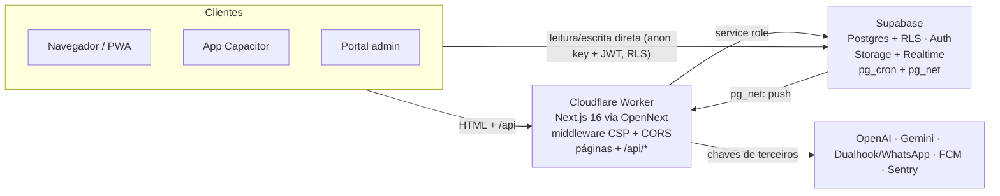

# QueroUmaCor — Dossiê técnico para replicação

18/10/2026

## 1. Visão geral

QueroUmaCor é uma rede social + caixa de ferramentas de negócio para profissionais de pintura, operada pela loja de tintas Cali Colors (Guarulhos/SP). Um único código web (Next.js) roda no navegador, como PWA e dentro de cascas nativas Android/iOS (Capacitor), mais um portal administrativo separado para a loja.

**Papéis (fonte única em `lib/roles.ts`):**

| Papel | O que faz no app |
| --- | --- |
| pintor | portfólio, orçamentos, agenda, financeiro, gestão de obras, tabela de preços |
| grafiteiro | portfólio, arte à venda, AR Grafite, revista Click Rua |
| automotivo (funileiro) | portfólio, orçamentos, gestão de obras |
| arquiteto / engenheiro | presta serviço e contrata (os dois lados) |
| cliente | busca profissionais, pede orçamento, compra na loja, acompanha obra |
| admin | tudo, mais o portal `/portal` (flag `portal_access`) |

**Modelo de negócio:**

- Não há pagamento dentro do app (regra Apple 3.1.3(e)). A loja recebe uma "Lista de Pedido" e fecha a venda pelo WhatsApp.
- O plano PRO é ativado manualmente pela loja ou por troca de pontos; libera ferramentas e cotas maiores de IA.
- O app gera tráfego e leads para a loja física; o portal faz a prospecção (leads + WhatsApp com IA).

## 2. Stack e arquitetura

O app inteiro é um Next.js servido por um Cloudflare Worker; o Supabase é banco, auth, storage e realtime; o celular só carrega o site ao vivo dentro de uma WebView.



O Worker só entra quando há segredo (IA, WhatsApp, push, admin); o banco devolve trabalho ao Worker pelo pg\_net (push e varreduras).

| Camada | Tecnologia | Observação |
| --- | --- | --- |
| Front + API | Next.js 16.3 (App Router), React 19, TypeScript | rotas de API em `app/api/*/route.ts`, lógica em `lib/api/_services/` |
| Estilo | Tailwind 4, tokens CSS em `:root` | modo escuro opt-in via `data-theme` |
| Estado/dados | TanStack Query 5, react-hook-form + Zod | `lib/hooks/` envolve `lib/services/` |
| Hospedagem | Cloudflare Workers via `@opennextjs/cloudflare` | `wrangler.jsonc`, envs `production`/`preview`, custom domain |
| Banco/Auth/Storage | Supabase PRO (Postgres + RLS, GoTrue, Storage, Realtime, pg\_cron, pg\_net) | 124 migrations em `/migrations` |
| Mobile | Capacitor 8 (Android + iOS), build no Codemagic | `server.url` aponta pro site em produção |
| Observabilidade | Sentry (client/server/edge) + tabela `errors` + `/admin/errors` | Web Vitals via browserTracing |
| PDF | jsPDF 4 no cliente | orçamento e pedido |
| 3D/AR | three.js, MediaPipe | AR Grafite, overlay de câmera |
| Portal admin | React 18 sem bundler em `public/portal/` (`app.jsx` → `app.js` compilado com Babel, SRI no `index.html`) | não passa pelo middleware |

**Estrutura de pastas (`next-app/`):**

- `app/` — uma pasta por tela (feed, perfil, chat, loja, obras, orcamento-ia, financeiro, agenda…) e `app/api/` com \~40 rotas.
- `components/` — shell (`AppShell`, `TopNav`, `BottomNav`, `BottomSheet`), auth, push, tour, toasts.
- `lib/services/` — um arquivo por domínio, sempre falando com o Supabase.
- `lib/api/` — segurança das rotas: `security.ts` (auth, rate limit, gates PRO/IA), `env.ts` (`getRuntimeEnv`), `ssrf-guard.ts`, `audit.ts`.
- `lib/native/` — a única fronteira com a casca nativa.
- `middleware.ts` — headers de segurança, CSP com nonce, CORS de `/api/*`, bloqueio de `Next-Action`.
- `__tests__/` — Vitest (68 entradas, \~2600 testes), incluindo testes que leem o fonte para travar regras de arquitetura.

**Fluxo de uma requisição:** o cliente fala direto com o Supabase (PostgREST com a anon key + JWT do usuário, protegido por RLS) para leitura e escrita comuns. Tudo que precisa de segredo (IA, WhatsApp, push, moderação, admin) passa por uma rota do Worker, que valida o token no GoTrue e usa a service role.

## 3. Casca mobile (Capacitor)

A casca é Capacitor 8 carregando `https://www.queroumacor.com.br` (`server.url`): deploy do site atualiza o app sem build nova; build nova só é necessária quando muda plugin, permissão ou config nativa.

**Decisão para o app novo (18/10/2026): mesmo modelo — casca carregando o site ao vivo.** O que isso exige, aprendido aqui:

- `offline.html` local no `webDir` + `errorPath`, senão sem rede o app não abre (risco de rejeição Apple 4.2).
- Nenhuma navegação de documento dentro da casca: falha ou cancelamento pinta o `errorPath` com a internet funcionando.
- Service worker que nunca cacheia erro e se recupera sozinho de 5xx.
- Domínio do site e do backend em `allowNavigation` e em `WKAppBoundDomains`.
- Um `/diag` mostrando qual build do site o aparelho está rodando.
- Plugin, permissão ou config nativa nova só chegam com build nova na loja.

**Identidades:** Android `br.com.queroumacor` (Play), iOS `br.com.queroumacor.app` (App Store, também o scheme do deep link OAuth `br.com.queroumacor.app://auth/callback`). São diferentes de propósito.

**Config relevante (`capacitor.config.ts`):** `errorPath: 'offline.html'` (página local quando o site não carrega), `allowNavigation` com o domínio e o host do Supabase, `limitsNavigationsToAppBoundDomains: true` no iOS (lista em `WKAppBoundDomains` no Info.plist), SplashScreen com `launchAutoHide: true` e 2500 ms, Keyboard `resize: 'native'`.

**Plugins instalados (`package.json` da raiz):**

| Plugin | Uso | Wrapper em `lib/native/` |
| --- | --- | --- |
| @capacitor-firebase/messaging | push FCM (Android e iOS) | `push.ts` |
| @capacitor/browser + @capacitor/app | OAuth no navegador do sistema + deep link de volta | `auth.ts`, `browser.ts`, `appState.ts` |
| @capacitor/camera | foto nativa, `pickImages` da galeria | `camera.ts` |
| @capacitor/filesystem | salvar imagem/PDF em Documents | `filesystem.ts` |
| @capacitor/share | share sheet nativo | `share.ts` |
| @capacitor/haptics | vibração em curtir, salvar, publicar, trocar aba | `haptics.ts` |
| @capacitor/status-bar, splash-screen, keyboard | chrome nativo | `statusBar.ts`, `splash.ts`, `keyboard.ts` |
| @capacitor/network | faixa "sem conexão" | `network.ts` |
| @capacitor/clipboard | copiar link | `clipboard.ts` |
| @capacitor/device | modelo/OS/versão no `/diag` | `device.ts` |
| @capawesome/capacitor-badge | número de não lidas no ícone | `badge.ts` |

Base: `@capacitor/core`, `@capacitor/android`, `@capacitor/ios`, `@capacitor/cli`. Instalação no app novo, seguida de `npx cap sync`:

```bash
npm i @capacitor/core @capacitor-firebase/messaging @capacitor/app @capacitor/browser @capacitor/camera @capacitor/filesystem @capacitor/share @capacitor/haptics @capacitor/status-bar @capacitor/splash-screen @capacitor/keyboard @capacitor/network @capacitor/clipboard @capacitor/device @capawesome/capacitor-badge
npm i -D @capacitor/cli @capacitor/android @capacitor/ios
```

**Regra de ouro:** componente nunca importa `@capacitor/*` nem toca `window.Capacitor`; só chama `@/lib/native`. Cada wrapper detecta o plugin, tem fallback web e teto de tempo (promessa pendurada em WebView não rejeita). Componentes montados no `AppShell`: `NativeChrome`, `NativeBadge`, `OfflineBanner`, `NativePushBridge`/`Router`.

**Build (`codemagic.yaml`):**

1. Workflow `android-aab`: calcula `versionCode` = maior da Play + 1, `cap sync`, monta `google-services.json` e `key.properties` a partir de variáveis do painel, gera AAB assinado e publica na faixa **internal**. Produção é promovida à mão.
2. Workflow `ios-ipa`: `cap sync ios` (nunca `cap add ios` de novo), `GoogleService-Info.plist` por variável, assinatura pela integração App Store Connect, build number = último do TestFlight + 1, sobe no TestFlight.

**Permissões Android que importam:** `RECORD_AUDIO` **e** `MODIFY_AUDIO_SETTINGS` (o Capacitor pede as duas para o microfone da WebView; faltando uma, o `getUserMedia` é negado sem diálogo), `CAMERA`, `POST_NOTIFICATIONS`, `allowBackup="false"` (a sessão mora na WebView).

## 4. Funcionalidades

O app tem cinco blocos: rede social, mensagens, loja, ferramentas de negócio (grade de tiles no perfil, filtrada por papel) e IA; o portal da loja é um sexto bloco à parte.

| Área | Funcionalidade | Telas / arquivos |
| --- | --- | --- |
| Social | Feed (RPC `get_feed_v2`, posts destacados no topo), carrossel até 5 fotos, vídeo, stories 24h, curtir/comentar/salvar, @menções e #hashtags, seguir, bloquear, denunciar, sugestões, "Em alta" | `/feed`, `/explore`, `/hashtag/[tag]`, `/post`, `/publicar` |
| Social | Publicar com enquadramento (1:1, 4:5, 16:9; recorte no arquivo antes do upload) e moderação no servidor | `app/publicar`, `lib/enquadramento.ts` |
| Perfil | Perfil público, portfólio, verificado, Instagram/site, formação, avaliações, pontos | `/perfil`, `/formacao`, `/avaliar`, `/pontos` |
| Busca | Full-text em português (pintores, posts, produtos) | `/search`, RPC `search_all` |
| Mensagens | Chat 1:1 e 3-way com a loja, envio otimista, moderação depois do envio, não lidas, respostas automáticas | `/chat` |
| Avisos | Sininho (`notifications`) + push nativo e web | `/notificacoes` |
| Loja | Seleção de lojas, catálogo (\~21 mil produtos, janela de 40 cards), variantes de tamanho, lista de pedido com chave de idempotência, Cores do Ano | `/loja`, `/pedidos` |
| Negócio | Orçamento com IA: vários serviços, itens da tabela de preços, desconto R$/%, PDF fiel ao modelo, editar/duplicar/modelo, aprovar por WhatsApp | `/orcamento-ia`, `/orcamentos`, `/pdf/[id]` |
| Negócio | Pipeline (kanban), CRM "reativar clientes", agenda, financeiro com categorias, anotações (texto e áudio), checklist, calculadora de tinta, frete, tabela de preços | `/crm`, `/agenda`, `/financeiro`, `/notes`, `/checklist`, `/calculadora`, `/frete`, `/tabela-precos` |
| Negócio | Gestão de obras: obras, equipe (convite por @tag ou sem conta), escala semanal, agenda do funcionário, acesso do cliente | `/obras` |
| Criativo | AR Grafite (câmera + arte sobreposta, girar, espelhar), arte à venda, logo com IA, camisetas personalizadas, revista Click Rua | `/perfil/grafites`, `/arte-venda`, `/ai-logo`, `/camisetas`, `/click-rua` |
| IA | Personas por papel: Alice, Seu Zé, Fê, Senna (chat, voz, TTS); legenda, transcrição, área por foto, OCR de recibo, análise financeira, sugestão de preço | `/alice`, `/seu-ze`, `/fe`, `/senna`, `app/api/*` |
| Conta | Login e-mail + Google + Apple, completar perfil, verificação de e-mail, exportar dados, excluir conta (LGPD), tema escuro, tour guiado, `/diag` | `/login`, `/signup`, `/completar-perfil`, `/delete-account`, `/diag` |
| Portal | Pessoas (editar, PRO, promover, excluir), produtos, lojas, pedidos, leads (61 mil, importação CSV/Excel), abordagem em lote por template, WhatsApp com IA e follow-up, chats 3-way, posts pendentes, uso do app, histórico de alterações | `public/portal/` |

## 5. Backend e dados (Supabase)

A segurança dos dados mora no Postgres: toda tabela tem RLS, o cliente nunca recebe a service role, e o que exige privilégio passa por RPC `SECURITY DEFINER` com `SET search_path` ou por rota do Worker.

| Domínio | Tabelas principais |
| --- | --- |
| Identidade | `profiles` (base, dono-ou-admin), view `profiles_public` (colunas seguras), `consent_log`, `deletion_tombstones` |
| Social | `posts` (status `pending`→`approved`, `media_urls[]`, `media_hash`, `deleted_at`), `comments`, `likes`, `follows`, `saved_posts`, `blocks`, `reports`, `notifications` |
| Mensagens | `messages` (`conversation_id` texto, `read_at`, `deleted_at`), `auto_responses`, `portal_chat_reads` |
| Loja | `stores`, `products`, `product_variants`, `orders` (`idempotency_key`) |
| Negócio | `quotes` (`quote_data` jsonb), `jobs`, `notes`, `checklists`, `obras`, `obra_equipe`, `obra_escala`, `price_table_items`, `reviews`, `points`, `referrals` |
| Billing/IA | `invoices`, `plan_limits`, `ai_usage`, `rate_limits` |
| WhatsApp/portal | `whatsapp_messages`, `whatsapp_ai_state`, `whatsapp_ai_config`, `portal_alerts`, `leads` |
| Segurança/ops | `audit_log`, `audit_events`, `errors`, `media_hash_blocklist`, `media_review_queue`, `push_subscriptions`, `push_device_tokens`, `app_settings` |

**Padrões usados em todo o schema:**

- Soft delete com `deleted_at` + índice parcial `WHERE deleted_at IS NULL` + hard delete por cron depois de 30 dias.
- Trigger `protect_profile_columns` reverte (e audita) tentativa do usuário de se dar `is_pro`, `portal_access`, `role='admin'` ou `verified`.
- `is_portal_admin()` sempre embrulhada como `(SELECT is_portal_admin())` na policy, para ser avaliada uma vez por statement e não uma por linha.
- Contadores (`followers_count`, `posts_count`) mantidos por trigger `SECURITY DEFINER`, nunca pelo app.
- Cota e rate limit atômicos no banco (`reserve_ai_usage`, `check_rate_limit` com chave texto, advisory lock).
- Notificação → trigger → `pg_net` chama `/api/push-notify` com segredo interno de `app_settings`.
- pg\_cron: limpeza de soft delete, mídia órfã, audit antigo, erros (90 dias), varredura de posts pendentes (10 min), follow-up do WhatsApp (1 h).

**Storage (buckets):** `posts` (foto/vídeo, 50 MB, path começa no `auth.uid()`), `avatars`, `art-refs`, `style-refs`, `exports` (PDFs, só `application/pdf`), `click-rua`, `whatsapp-media` (privado, URL assinada).

**Realtime:** `messages`, `notifications`, `whatsapp_messages` (REPLICA IDENTITY FULL). Broadcast para avisos que o RLS esconderia (mensagem removida pela moderação).

## 6. Integrações

Toda integração com segredo vive numa rota do Worker e lê a chave por `getRuntimeEnv()`; nenhuma chave de terceiro chega ao cliente.

| Serviço | Para quê | Onde |
| --- | --- | --- |
| OpenAI | chat das personas, legenda, transcrição (Whisper), TTS, logo, IA do WhatsApp (`gpt-4o-mini` por padrão) | `lib/api/_ai.ts`, `_services/*` |
| Google Gemini | moderação de imagem/vídeo, arte para Instagram, resolver cor | `moderate.ts`, `moderate-video.ts`, `ig-art.ts` (chave no header `x-goog-api-key`, nunca na URL) |
| WhatsApp Cloud API via Dualhook | envio (texto/template), webhook de entrada, status de entrega, mídia, ecos do celular | `_services/whatsapp*.ts`, `/api/whatsapp/*` |
| Firebase Cloud Messaging v1 | push nativo Android/iOS (JWT RS256 assinado no edge, sem dependências) | `_services/fcm.ts` |
| Web Push (VAPID) | push no navegador/PWA (aes128gcm feito à mão) | `/api/push-notify` |
| Sentry | erros e Web Vitals, com redação de PII em `beforeSend` | `sentry.*.config.ts`, `lib/sentry-helpers.ts` |
| Cloudflare Image Resizing | `/cdn-cgi/image/w=..,f=auto/` para fotos do Supabase (origens restritas) | `lib/cfImg.ts` |
| Google / Apple OAuth | login social via Supabase, PKCE | `AuthProvider`, `lib/native/auth.ts` |
| IBGE | lista de cidades por UF no cadastro | `/api/cidades` |
| Mercado Pago | código mantido (checkout PRO web + webhook com HMAC), sem chamada na UI | `/api/checkout`, `/api/mp-webhook` |

**WhatsApp com IA (portal):** mensagem entra pelo webhook → grava em `whatsapp_messages` (wamid UNIQUE, idempotente) → depois da resposta (`ctx.waitUntil`) o runner decide: opt-out "PARE" > IA desligada > fora do horário (manda ausência, 1 a cada 12 h) > teto de 30 respostas/dia > responde. Pergunta de preço escala para humano por trava de código, não só por prompt. O prompt base é editável no portal; o formato JSON e as travas são fixos.

**Push ponta a ponta:** INSERT em `notifications` → trigger → `pg_net` → `/api/push-notify` → FCM (tokens de `push_device_tokens`, gravados pela RPC `upsert_push_device_token`) e Web Push (`push_subscriptions`, endpoint em allowlist de hosts). Mensagem de chat vai sem o texto no push (só "Fulano enviou uma mensagem").

## 7. Segurança

A segurança tem quatro camadas: borda (headers e WAF), rotas (auth + rate limit + gates), banco (RLS + triggers) e conteúdo (moderação no servidor).

- **Headers no `middleware.ts`, não no `next.config`:** CSP com nonce por requisição, HSTS preload, X-Frame-Options, Permissions-Policy, COOP/CORP, CORS restrito em `/api/*`. No OpenNext os headers do middleware vencem os da rota; script inline usa o nonce lido da CSP do request.
- **Assets estáticos (portal):** `public/_headers` com CSP hash-only, porque o binding ASSETS não passa pelo middleware.
- **Rotas:** `requireAuth` valida o JWT no GoTrue; `gateProAI`/`gateAiUsage` checam PRO e cota mensal; `checkRateLimit` no banco; `rejectOversizedBody` antes do parse; `ensurePortalAdmin` (allowlist `ADMIN_EMAILS` ou `portal_access`). Tudo fail-closed em produção.
- **Env:** URL e anon key do Supabase saem sempre do mesmo par (`resolveSupabaseEnv`); um teste falha se alguém ler `process.env` cru em `lib/api`.
- **Banco:** bloqueio aplicado nas escritas (`blocked_between` no WITH CHECK de mensagens, follows, likes, comentários); e-mail confirmado exigido no INSERT de posts/mensagens/comentários; RPCs SECURITY DEFINER derivam o usuário de `auth.uid()`, nunca de parâmetro.
- **Conteúdo:** post nasce `pending`; `/api/posts/approve` baixa cada mídia, confere o hash contra `media_hash_blocklist`, roda Gemini e copia para `posts/approved/` antes de publicar. Varredura por cron pega pendentes órfãos.
- **SSRF:** allowlist de hosts para endpoints de push; blocklist de IP privado para URLs devolvidas por IA, revalidada depois de redirects.
- **Mobile:** OAuth PKCE pelo navegador do sistema; token de push desassociado no logout; Eruda só com flag de build.
- **Webhooks:** WhatsApp autenticado por segredo na URL + IDs do envelope; Mercado Pago por HMAC com janela anti-replay. Sempre 200 depois de autenticar (evita reenvio infinito).

## 8. CI/CD e operação

Merge na `main` só com o check `validate` verde; produção sobe por disparo manual do `deploy.yml`, e SQL é rodado à mão no SQL Editor do Supabase.

| Workflow | O que faz |
| --- | --- |
| `ci.yml` (`validate`) | `npm ci`, `tsc --noEmit`, eslint, vitest, `npm audit` de produção (falha em HIGH/CRITICAL) |
| `deploy.yml` | `opennextjs-cloudflare build` + remoção de source maps + checagem de `.map`/`.env` no artefato + `wrangler deploy --env production`; só da `main` |
| `codeql.yml` | SAST JavaScript/TypeScript (actions fixadas por SHA) |
| `security.yml` | gitleaks + SBOM CycloneDX |
| `rollback.yml` | volta a `main` para um SHA escolhido |
| `smoke-test-workers.yml`, `uptime.yml`, `load-test.yml` | testes pós-deploy, ping de saúde, carga k6 |
| Codemagic | AAB (Play internal) e IPA (TestFlight), disparo manual |

**Rotina de entrega usada no projeto:**

1. Branch → PR → CI verde → squash merge.
2. Disparar `deploy.yml` e conferir que terminou `success`.
3. Se houver SQL: colar no SQL Editor (statements curtos, um por vez pelo celular), rodar a consulta de conferência que volta `ok=true` por item.
4. Abrir o app num aparelho real depois de qualquer bump de *minor* do Next ou mudança de boot da casca.
5. Registrar no `CLAUDE.md` na hora: o que mudou, PR, run do deploy, SQL rodado ou não.

**Diagnóstico em produção:** `/diag` (build do site, SW no comando, plugins nativos, estado do perfil), `/admin/errors` (tipos derivados de `FAILURE_TYPE_LABELS`, filtro por usuário), `reportFailure()` em todo `catch` que mostra erro na tela, `/api/health`.

## 9. Lições aprendidas (regras para levar)

Cada regra abaixo custou um incidente real em produção; copiar as regras sai mais barato que repetir os incidentes.

| Regra | Incidente que a criou |
| --- | --- |
| Na casca, nunca navegar o documento (`window.location`); usar `router.push` e `window.open(url,'_blank')` para link externo | Apple rejeitou: login e logout pintavam a tela "Sem conexão" (`errorPath`) |
| Todo `await` de rede no boot tem teto de tempo | `getSession()` pendurado deixava o app em "Carregando" para sempre |
| Service worker nunca cacheia resposta com erro; 5xx vira tela de reconexão com auto-retry | 500 cacheado = app quebrado mesmo com internet boa |
| Secrets do edge só por `getRuntimeEnv()`, nunca no module-load | portal admin devolvia 403 com a env configurada |
| URL e anon key do Supabase do mesmo par | "Faça login" em toda IA por chave de outro projeto |
| `update` do Supabase sem `.select()` não avisa zero linhas | loop no completar-perfil: salvava "com sucesso" e nada gravava |
| Trigger que engole exceção esconde erro de schema; conferir schema real antes de INSERT | `username NOT NULL` impediu todo cadastro; `quotes.post_id` inexistente |
| Função em policy RLS embrulhada em `(select …)` | `statement timeout` na lista de WhatsApp |
| Validar arquivo por tipo → extensão → bytes; recusar só com prova | seletor do Android manda arquivo sem MIME |
| Comprimir mídia acima de 2 MB antes do upload, e repetir uma vez em caminho novo | "Failed to fetch" ao publicar foto da câmera nativa |
| `flex-1` em campo de texto pede `min-w-0`; usar `dvh` e fonte ≥ 16px em input no celular | tela cortada e zoom automático no iPhone |
| Hook com canal realtime usa nome único por instância (`useId`) | app logado caiu no error boundary |
| Trocou arte estática servida pelo SW → troque o nome do arquivo | splash com duas legendas sobrepostas |
| Arquivo de rota do Next só exporta os campos permitidos | deploy quebrado sem `tsc` nem vitest acusarem |
| Não publicar R8/minify nem mudança de boot da casca sem abrir o AAB | app parou na splash |
| Falha de envio nunca responde 502/504 (o Cloudflare troca o corpo) | operador via "Bad gateway" sem motivo |
| Lista de pendência não é evidência: conferir no banco antes de afirmar | 7 de 9 pendências anotadas estavam erradas |

## 10. Checklist de replicação

A ordem abaixo monta o mesmo esqueleto do zero; cada item aponta o arquivo deste repo que serve de modelo.

**Base web**

- [ ] Next.js 16 + TypeScript + Tailwind 4 + TanStack Query + Zod (`next-app/package.json`)
- [ ] `@opennextjs/cloudflare` + `wrangler.jsonc` com envs `production`/`preview` e custom domain
- [ ] `lib/api/env.ts` (`getRuntimeEnv`) e `lib/api/security.ts` (auth, rate limit, gates) antes da primeira rota
- [ ] `middleware.ts` com CSP + nonce e headers de segurança
- [ ] `AppShell` com guard de login, `TopNav`, `BottomNav`, `BottomSheet`, toasts, `error.tsx`/`global-error.tsx`
- [ ] Service worker com regra "erro nunca entra no cache" e página de reconexão (`public/sw.js`)

**Supabase**

- [ ] `profiles` + view pública + trigger `handle_new_user` (sem engolir erro) + `protect_profile_columns`
- [ ] RLS em toda tabela no mesmo `CREATE TABLE`; `is_portal_admin()` com `(select …)`
- [ ] Buckets com path começando no `auth.uid()` e `allowed_mime_types`
- [ ] `rate_limits` + `check_rate_limit(text,…)`, `ai_usage` + `reserve_ai_usage`, `audit_log`, `errors`
- [ ] pg\_cron para limpezas; pg\_net + `app_settings` para push
- [ ] Consulta de conferência por migration (uma linha `ok` por item)

**Mobile**

- [ ] `npx cap add android` / `ios` uma vez, versionar `android/` e `ios/`, depois só `cap sync`
- [ ] `capacitor.config.ts` com `server.url`, `errorPath` local, `allowNavigation` incluindo o Supabase
- [ ] `lib/native/` com wrappers feature-detected e timeout; nada importa plugin direto
- [ ] Firebase (Android + Apple), APNs `.p8` no Firebase, `google-services.json`/`GoogleService-Info.plist` por variável no CI
- [ ] OAuth: provedores no Supabase, redirect `app.scheme://auth/callback`, PKCE
- [ ] `codemagic.yaml` com versionCode/build number automáticos, keystore e App Store Connect no painel
- [ ] Info.plist com textos de permissão, `PrivacyInfo.xcprivacy`, `assetlinks.json` com o SHA-256 do App Signing

**Operação**

- [ ] CI com `validate` obrigatório, CodeQL, gitleaks, deploy manual só da `main`
- [ ] Sentry com redação de PII; `/diag` e `/admin/errors` desde o início
- [ ] Um `CLAUDE.md` vivo: decisões, SQL rodado, deploys, lições — registrado na hora

Documentos de apoio no repo: `docs/produto/` (PRD, TRD, APP\_FLOW, UI\_UX, BACKEND\_SCHEMA), `docs/NATIVE_BRIDGE.md`, `docs/ANDROID_AAB_CODEMAGIC.md`, `docs/IOS_BUILD.md`, `docs/PUSH_NOTIFICATIONS.md`, `docs/WHATSAPP_CLOUD_API.md`, `docs/INCIDENT_RESPONSE.md`.

## 11. Complementos: envs, permissões, lojas e domínio

Estes são os itens de configuração fora do código que um app novo precisa recriar; nenhum deles aparece num diff.

**Variáveis de ambiente (Worker; secrets via `wrangler secret put` ou painel):**

| Variável | Tipo | Para quê |
| --- | --- | --- |
| `NEXT_PUBLIC_SUPABASE_URL`, `NEXT_PUBLIC_SUPABASE_ANON_KEY` | pública (build) | cliente Supabase; sempre o mesmo par |
| `SUPABASE_SERVICE_ROLE_KEY` | secret | rotas com privilégio |
| `NEXT_PUBLIC_SENTRY_DSN` | pública (build) | Sentry |
| `OPENAI_API_KEY`, `GEMINI_API_KEY`, `WHATSAPP_AI_MODEL` | secret | IA e moderação |
| `NEXT_PUBLIC_VAPID_PUBLIC_KEY`, `VAPID_PRIVATE_KEY`, `VAPID_SUBJECT`, `PUSH_INTERNAL_SECRET` | pública + secrets | web push e chamada interna do banco |
| `FCM_PROJECT_ID`, `FCM_CLIENT_EMAIL`, `FCM_PRIVATE_KEY` | secret | push nativo |
| `DUALHOOK_API_KEY`, `WHATSAPP_PHONE_NUMBER_ID`, `WHATSAPP_WABA_ID`, `WHATSAPP_WEBHOOK_VERIFY_TOKEN`, `WHATSAPP_WEBHOOK_URL_SECRET`, `WHATSAPP_FOLLOWUP_URL_SECRET` | secret | WhatsApp |
| `ADMIN_EMAILS` | secret | porta de emergência do admin |
| `MP_ACCESS_TOKEN`, `MP_WEBHOOK_SECRET` | secret | só se usar Mercado Pago |

No Codemagic: `GOOGLE_SERVICES_JSON` e `GOOGLE_SERVICE_INFO_PLIST` (base64), keystore Android, credencial da conta de serviço da Play e integração App Store Connect.

**Permissões nativas:**

- Android (`AndroidManifest.xml`): `INTERNET`, `ACCESS_NETWORK_STATE`, `CAMERA`, `RECORD_AUDIO` + `MODIFY_AUDIO_SETTINGS`, `POST_NOTIFICATIONS`, `VIBRATE`, `ACCESS_COARSE_LOCATION`; intent-filter do scheme do OAuth; `allowBackup="false"`.
- iOS (`Info.plist`): `NSCameraUsageDescription`, `NSMicrophoneUsageDescription`, `NSLocationWhenInUseUsageDescription`, `NSPhotoLibraryUsageDescription`, `NSPhotoLibraryAddUsageDescription`, `WKAppBoundDomains` (site com e sem www + host do Supabase), URL scheme do OAuth, `App.entitlements` com `aps-environment`, `PrivacyInfo.xcprivacy`. Não declarar `NSUserTrackingUsageDescription` sem usar rastreamento (causou recusa).

**Exigências das lojas:**

- Excluir conta dentro do app **e** numa URL pública (`/delete-account`, exigência da Play).
- Política de privacidade, termos e contato públicos (`/info/*`), com a data de atualização real.
- Nada de compra de bem digital fora do IAP no iOS: aqui a loja só gera lista de pedido e o PRO é ativado fora do app.
- Idade mínima validada no cadastro (aqui 18+), moderação de conteúdo, denunciar e bloquear usuário (regra 1.2 da Apple para UGC).
- Login com Apple sempre que houver login com Google no iOS.
- App Privacy label e Data Safety preenchidos (`docs/APP_STORE_PRIVACY_LABEL.md`, `docs/PLAY_STORE_CHECKLIST.md`).
- `assetlinks.json` em `/.well-known/` com o SHA-256 do App Signing da Play.

**Domínio, Cloudflare e Supabase Auth:**

- Custom domain (com e sem www) apontando pro Worker, declarado em `routes` do `wrangler.jsonc` (senão o deploy remove).
- SSL Full (Strict), HSTS com preload, DNSSEC com DS no registrador, registros CAA.
- WAF: allowlist do path do webhook do WhatsApp e de `assetlinks.json`; bot fight bloqueia testes de CI vindos de datacenter.
- Image Transformations com origens restritas (a própria zona + `/storage/v1/object/public/` do Supabase).
- Token da API Cloudflare do deploy com `Workers Scripts: Edit` e `Zone > Workers Routes: Edit`.
- Supabase Auth: Site URL, Redirect URLs (`/completar-perfil`, scheme do app), provedores Google e Apple, proteção de senha vazada, rotação de refresh token.
- E-mail do domínio com SPF/DKIM/DMARC para os e-mails de auth.
